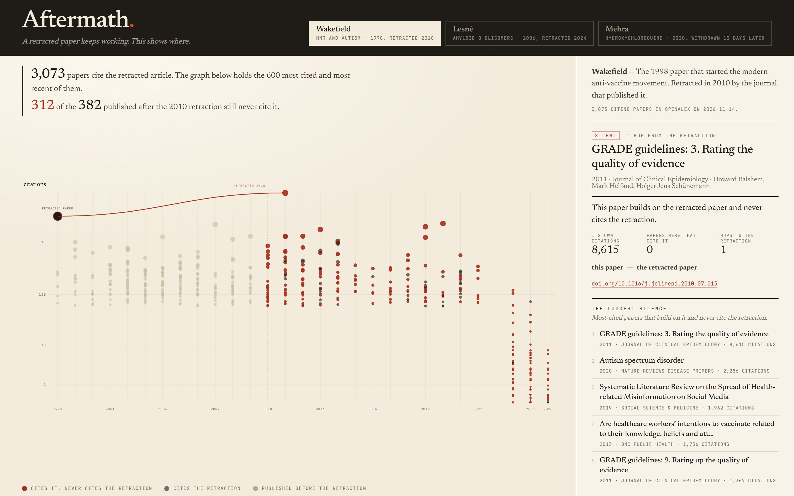

# Aftermath

**A retracted paper keeps working. This shows where.**

Wakefield's 1998 paper was retracted in 2010. It still has 3,073 citations.
Of the 382 most-cited papers that cite it *after* the retraction, **312 never
mention that it was retracted at all**. Aftermath reads that straight off the
real citation graph and draws it: time across, influence up, and one colour for
the papers that kept building on it without ever saying so.



## The question

Retraction is supposed to correct the record. It does not travel.

Every citation is an edge, so the answer is not a list — it is reachability
plus a set difference:

```cypher
// who cites the paper
MATCH (w:Work)-[:CITES]->(s:Work {role:'seed'})
// but never the retraction, and only once the retraction existed
WHERE NOT (w)-[:CITES]->(:Work {role:'notice'})
  AND w.year >= $noticeYear
RETURN count(w)
```

That is why this needs a graph and not a spreadsheet: "still building on it"
and "never corrected" are two paths out of the same node, and the difference
between them is the whole point.

## Three case files, real data

| case | field | notice | sampled | silent after the retraction |
| --- | --- | --- | --- | --- |
| Wakefield 1998 | MMR and autism | 2010 | 600 | **312 of 382** |
| Lesné 2006 | amyloid-β oligomers | 2024 | 598 | **107 of 107** |
| Mehra 2020 | hydroxychloroquine | 2020 (13 days later) | 581 | **403 of 581** |

The data is a snapshot of [OpenAlex](https://openalex.org) (CC0) taken on
**2026-11-14**. It is fetched by `scripts/fetch-cascades.mjs` and committed as
JSON; the app makes **no network requests at all** — the whole graph, 1,700
papers and 8,000 citations, is rebuilt in the tab on every load.

Two decisions that keep the numbers honest:

1. **A paper cannot be blamed for silence before the retraction existed.**
   Papers published earlier are drawn grey and excluded from the count. Without
   that rule the Lesné case reads "100% silent" for the wrong reason.
2. **The sample is stated.** We take the most-cited and the most recent citers,
   up to ~600 per case, not all 3,073 — and the app says so in the headline and
   in the panel. Every number is re-derivable by re-running the fetch script.

## What you can do

- **Click any dot.** You get the paper, its year, its journal, its own citation
  count, whether it acknowledges the retraction, and the chain of citations that
  leads back to the retracted article — a real shortest path, not a guess.
- **Read the plate.** Left of the dashed line is before the retraction; right of
  it, red means "cites the article, not the retraction", ink means it cites the
  retraction, grey means it predates it.
- **Use the list.** *The loudest silence* ranks the silent papers by their own
  citation count — the ones where the uncorrected claim travels furthest.

## Run it

```bash
npm ci
npm run dev        # http://localhost:4321
npm run build && npm run preview
bash scripts/verify.sh   # type check, 18 tests, build, 12 browser checks, UI measurement
npm run fetch      # re-pull the cascades from OpenAlex
```

## How it is built

| file | what it does |
| --- | --- |
| `scripts/fetch-cascades.mjs` | OpenAlex → `public/data/*.json`. Two slices: most cited, most recent. |
| `src/data.ts` | Loads a cascade into Relate; derives **silent** from three facts, never stores it. |
| `src/queries.ts` | Every question, and the Cypher that answers it. |
| `src/cascade.ts` | The plate: time × influence, log axis, collision-safe stacking. |
| `src/render.ts` | One SVG, three colours, no chart library. |
| `src/db.ts` | Relate compiled to WebAssembly, opened once. |

Relate features in use: embedded engine with no server, openCypher with
variable-length paths, `shortestPath`, `length()`, `nodes()`, `sum(CASE …)`,
`UNWIND` batch writes, property indexes.

## Licence

MIT for the code. The citation data is CC0 from OpenAlex; the retraction facts
come from the publishers' own notices.
